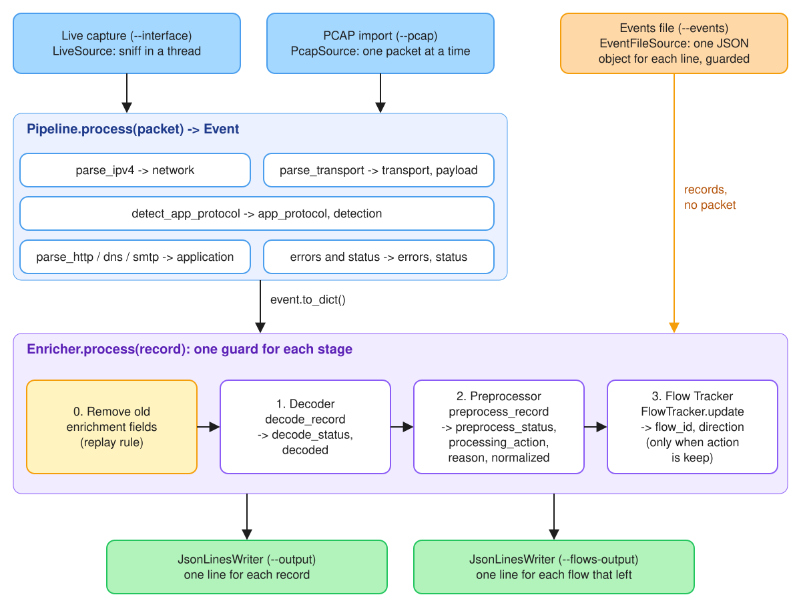

# NT204.R11.ANTN_PhanBanNhatNam_24521122

This repository holds the coursework for the course *Intrusion Detection and Prevention Systems* (NT204) at UIT. The project is a simple Intrusion Detection System (IDS) in Python, built across several assignments.

Assignment 01 builds the **packet capture and parser module**. The module reads packets from a live network interface or from a PCAP file, parses them, and writes one normalized event per packet as JSON Lines. The detection engine of the later assignments reads only these events. It never reads a Scapy packet.

Assignment 02 adds three stages after the parser: a **Decoder**, a **Preprocessor**, and a **Flow Tracker**. The stages decode URL-encoded and MIME-encoded values, give each event a consistent `normalized` view, and group the events into network flows. The module writes the flows to a second JSON Lines file.

## Contents

1. [Overview and scope](#1-overview-and-scope)
2. [Installation](#2-installation)
3. [Usage](#3-usage)
4. [Architecture](#4-architecture)
5. [Event schema](#5-event-schema)
6. [Application protocol detection](#6-application-protocol-detection)
7. [Error handling](#7-error-handling)
8. [Tests](#8-tests)
9. [Limitations](#9-limitations)
10. [AI usage disclosure](#10-ai-usage-disclosure)

## 1. Overview and scope

| Layer | Supported protocols |
|---|---|
| Network | IPv4 |
| Transport | TCP, UDP |
| Application | HTTP/1.x, DNS, SMTP |

The module:

- captures packets from a live interface, or reads them from a PCAP or pcapng file, through one shared pipeline;
- reads records from a JSON Lines events file as a third source (`--events`);
- parses IPv4, TCP, UDP, HTTP/1.x, DNS, and SMTP;
- detects the application protocol from the payload, and uses the port only as a hint;
- never stops on a malformed, truncated, or unsupported packet or record;
- writes every event to a JSON Lines file, one event per line;
- writes one record for each network flow to a second JSON Lines file.

Three stages run on every event after the parser. A stage reads the output of the earlier stages, and it reads a plain `dict`, never a Scapy packet.

| Stage | Reads | Writes |
|---|---|---|
| Decoder | `application` and the payload | `decode_status`, `decoded` |
| Preprocessor | the base fields | `preprocess_status`, `processing_action`, `reason`, `normalized` |
| Flow Tracker | `normalized`, for the events with `processing_action="keep"` | `flow_id`, `direction`, and the flows file |

The Decoder handles percent encoding, form encoding, HTML entities, Base64, Quoted-Printable, MIME messages, and charsets. The Preprocessor validates the record and normalizes the protocol name, the IP address, the port, the flags, the host, the path, and the time. The Flow Tracker groups TCP and UDP packets by their endpoints, follows the TCP connection state, and counts packets and bytes. The stages do not change the Assignment 01 fields. The new fields are in [section 5](#5-event-schema).

## 2. Installation

The project is tested with Python 3.14.5, Scapy 2.7.0, and pytest 8.4.2. It needs Python 3.11 or newer. Scapy needs no external binary.

```bash
python3 -m venv .venv
source .venv/bin/activate
pip install -r requirements.txt
```

Live capture needs root on macOS and Linux. Run it with the Python of the virtual environment, because `sudo` does not keep the activated environment:

```bash
sudo .venv/bin/python main.py --interface en0
```

To list the interface names on macOS, use `ifconfig -l`. On Linux, use `ip link`.

## 3. Usage

```text
python main.py (--interface IFACE | --pcap FILE | --events FILE) [--output FILE] [--unknown {keep,drop}]
               [--count N] [--payload {preview,full}] [--payload-limit N] [--tcp-timeout SEC]
               [--udp-timeout SEC] [--max-flows N] [--flows-output FILE]
```

| Option | Default | Meaning |
|---|---|---|
| `--interface IFACE` | — | Capture live traffic from the interface `IFACE`. |
| `--pcap FILE` | — | Read packets from the PCAP or pcapng file `FILE`. |
| `--events FILE` | — | Read JSON Lines records from `FILE`. A record can come from an earlier run. The stages write their fields again. |
| `--output FILE` | `events.jsonl` | Write the events to `FILE`. The run overwrites an existing file. |
| `--unknown {keep,drop}` | `keep` | `keep` writes an unsupported packet as an event with `app_protocol="UNKNOWN"`. `drop` does not write an unsupported packet or an `invalid` record (see [section 7](#status-values)). |
| `--count N` | no limit | Stop after `N` packets, or after `N` records of an events file. `N` must be at least 1. |
| `--payload {preview,full}` | `full` | `full` stores the payload in `payload_hex`. `preview` leaves `payload_hex` `null`, and the Decoder reads the 64-byte `payload_preview`. The Decoder adds a `limit` entry when this cut shortens a payload that it reads. |
| `--payload-limit N` | `4096` | The largest payload in bytes that `payload_hex` stores and that the Decoder reads. |
| `--tcp-timeout SEC` | `120.0` | The idle time after which a TCP flow ends. The unit is seconds of packet time. |
| `--udp-timeout SEC` | `30.0` | The idle time after which a UDP flow ends. The unit is seconds of packet time. |
| `--max-flows N` | `100000` | The largest number of active flows. When the table is full, the oldest flow leaves with `end_reason="evicted"` (see [section 9](#9-limitations)). |
| `--flows-output FILE` | `flows.jsonl` | Write the flow records to `FILE`. The run overwrites an existing file. |

`--interface`, `--pcap`, and `--events` are mutually exclusive, and one of them is required. `--output` and `--flows-output` must name two files, and neither can be the input file.

The idle time uses the time of the packets, not the clock of the computer. A flow is idle when the time since its last packet is larger than the timeout. A flow of exactly the timeout length stays.

Examples:

A PCAP file. The run writes `events.jsonl` and `flows.jsonl`:

```bash
python main.py --pcap tests/fixtures/all.pcap --output events.jsonl
```

A live capture (needs root):

```bash
sudo .venv/bin/python main.py --interface en0 --count 100 --output /tmp/live.jsonl
```

An events file. The file holds three records, and one of them has an IPv4 address with a leading zero:

```bash
python main.py --events tests/fixtures/events/protocol_and_ip.jsonl --output events_in.jsonl --flows-output flows_in.jsonl
```

A tuned run. The fixture holds one UDP flow at 0 s, a second flow at 100 s, and the first flow again at 200 s. The default timeout of 30 seconds gives three flows. The timeout of 1000 seconds joins the first and the third group into one flow of four packets, so the run writes two flows. `--payload preview` leaves `payload_hex` `null`:

```bash
python main.py --pcap tests/fixtures/idle_timeout.pcap --udp-timeout 1000 --payload preview --output tuned.jsonl --flows-output tuned_flows.jsonl
```

At the end of a run, the program prints a summary on stderr. The events go to the output file, so the two streams never mix. This is the summary of the first example:

```text
packets read: 139
events written: 139
ok: 134
partial: 0
unsupported: 5
malformed: 0
other: 0
preprocess valid: 134
preprocess partial: 5
preprocess invalid: 0
preprocess other: 0
dropped: 0
flows written: 16
elapsed: 0.020s
```

`packets read` counts the lines of an events file, when the source is one. The first group of status lines counts the parser `status` of the events written, and `other` counts an event with no known `status`. The second group counts `preprocess_status`. `dropped` counts the events that `--unknown drop` removed. `flows written` counts the lines of the flows file.

Exit codes:

| Code | Meaning |
|---|---|
| 0 | The run finished, or Ctrl-C stopped it. Ctrl-C closes the output file and prints the summary. |
| 1 | A file cannot be opened, live capture has no root permission, or the interface does not exist. The program prints one error line and no traceback. |
| 2 | The command line is not valid. For example, two sources, or `--output` and `--flows-output` that name one file. |

## 4. Architecture



The events file source skips `Pipeline.process`, because its records are already `dict` values.

| Module | Role |
|---|---|
| `main.py` | Entry point. It parses the arguments and calls `ids.cli.run`. |
| `ids/cli.py` | Selects the source, runs the one loop, writes the events and the flows, and prints the summary. |
| `ids/config.py` | `Config`: the options of one run, with their defaults. |
| `ids/contract.py` | The field names, the status values, and the error types that the three stages share. |
| `ids/capture/base.py` | `PacketSource`: the interface that both sources implement. |
| `ids/capture/pcap.py` | `PcapSource`: reads a capture file as a stream, so a large file never loads into memory. |
| `ids/capture/live.py` | `LiveSource`: runs Scapy `sniff` in a thread and hands each packet to the loop through a queue. |
| `ids/capture/events.py` | `EventFileSource`: reads an events file one line at a time. A bad line becomes an `invalid_record` entry, not an exception. |
| `ids/pipeline.py` | Runs the parser stages in order. It wraps each stage, so a failure keeps the layers that are already parsed. It also fills `payload_hex`. It does not run the three new stages. |
| `ids/parsers/network.py` | Parses the IPv4 header (RFC 791). |
| `ids/parsers/transport.py` | Parses the TCP header (RFC 793) or the UDP header (RFC 768), and extracts the payload. |
| `ids/parsers/detector.py` | The Application Protocol Detector. |
| `ids/parsers/http.py` | Parses an HTTP/1.x request or response (RFC 7230). |
| `ids/parsers/dns.py` | Reads DNS names with pointer safety, and parses a DNS message (RFC 1035). |
| `ids/parsers/smtp.py` | Parses SMTP commands, replies, and data lines (RFC 5321). |
| `ids/events.py` | The event dataclasses and their conversion to JSON-compatible values. |
| `ids/output.py` | `JsonLinesWriter`: writes one event or one record per line. |
| `ids/enrich.py` | `Enricher`: runs the Decoder, the Preprocessor, and the Flow Tracker on one record. Each stage has its own guard, so a failure writes the default fields and the later stages skip. |
| `ids/stages/decoder.py` | `decode_record`: decodes the target, the body, and the payload of a record. |
| `ids/stages/mime.py` | Base64 and Quoted-Printable decoding, SMTP message framing, and the MIME message reader. |
| `ids/stages/preprocessor.py` | `preprocess_record`: validates a record and builds the `normalized` object. |
| `ids/stages/flow.py` | `FlowTracker`: the flow key, the endpoints, the TCP state machine, the counters, the timeouts, and the flow records. |

Two design rules hold the architecture together:

- **One pipeline.** Live capture and PCAP import share every stage after the source. Only `cli.run` calls `Pipeline.process`.
- **One enricher.** The three stages run inside `Enricher.process`, and only `cli.run` calls it. The stages read a `dict`, so an events file and a capture file take the same path.
- **One library boundary.** Only `ids/capture/` and `ids/parsers/` import Scapy. An event holds JSON-compatible values only, so the detection engine never needs Scapy.

## 5. Event schema

Every line of the output file is one JSON object: one event. A packet source gives one event for each captured packet. An events file (`--events`) gives one event for each input line. A field that a layer does not have is `null`. An event from an events file holds only the base fields that its input line holds. The enrichment fields and the keys of `normalized` are always present.

### Event

| Field | Type | Meaning |
|---|---|---|
| `packet_id` | int | 1-based counter of the packets read in the run. A dropped packet still takes an id, so a gap in the ids shows a dropped packet. |
| `timestamp` | float | Capture time in epoch seconds. |
| `timestamp_iso` | string | The same time in ISO 8601, always UTC. |
| `source` | string | `"pcap:<file>"` or `"live:<interface>"`. For an input line that is not a JSON object, the events file reader writes `"events:<file>:<line>"`. |
| `length` | int | Captured length of the packet in bytes. |
| `link_type` | string | `Ethernet`, `Loopback`, `LinuxSLL`, `RawIP`, or the Scapy class name. |
| `network` | object or null | IPv4 fields. `null` when the packet is not IPv4. |
| `transport` | object or null | TCP or UDP fields. `null` when the packet has no supported transport. |
| `app_protocol` | string | `HTTP`, `DNS`, `SMTP`, or `UNKNOWN`. |
| `detection` | object | How the application protocol was decided. |
| `application` | object or null | Protocol-specific fields. `null` when no application parser ran. |
| `payload_len` | int | Length of the application payload in bytes, 0 when there is none. |
| `payload_preview` | string | The first 64 payload bytes as lower-case hex, `""` when there is no payload. |
| `status` | string | `ok`, `partial`, `unsupported`, or `malformed` (see [section 7](#7-error-handling)). |
| `errors` | list | One entry per fault: `{"stage", "type", "message"}`. Empty when there is no fault. |
| `payload_hex` | string or null | The payload bytes as lower-case hex, cut at `--payload-limit` bytes. `""` when the packet has no payload. `null` with `--payload preview`. |

### `network` (IPv4)

| Field | Type | Meaning |
|---|---|---|
| `protocol` | string | Always `IPv4`. |
| `src_ip`, `dst_ip` | string | Source and destination address. |
| `version` | int | The version field of the header. |
| `header_len` | int | Header length in bytes (IHL × 4). |
| `dscp` | int | Differentiated Services Code Point: the high 6 bits of byte 1. |
| `total_len` | int | Total length of the datagram in bytes. |
| `identification` | int | Identification field. |
| `flags` | list of string | `DF` and `MF` when they are set. |
| `frag_offset` | int | Fragment offset **in bytes**. The header counts 8-byte units, and the parser multiplies the value by 8. |
| `ttl` | int | Time to live. |
| `proto_number` | int | IP protocol number. |
| `proto_name` | string | `ICMP`, `TCP`, `UDP`, or the number as a string. |
| `checksum` | int | Header checksum. |
| `has_options` | bool | True when the header has options. |

### `transport` (TCP or UDP)

| Field | Type | Protocol | Meaning |
|---|---|---|---|
| `protocol` | string | both | `TCP` or `UDP`. |
| `src_port`, `dst_port` | int | both | Source and destination port. |
| `payload_len` | int | both | Payload length in bytes. |
| `checksum` | int | both | Header checksum. |
| `length` | int or null | UDP | Length field: header plus payload. |
| `seq`, `ack` | int or null | TCP | Absolute sequence and acknowledgment number. |
| `data_offset` | int or null | TCP | Header length in 32-bit words. |
| `flags` | list of string | TCP | Names of the set flags: `FIN SYN RST PSH ACK URG ECE CWR`. |
| `flags_raw` | int or null | TCP | The flag byte as a number. |
| `flags_str` | string or null | TCP | Scapy notation, for example `SA`. |
| `window` | int or null | TCP | Window size. |
| `urgent_ptr` | int or null | TCP | Urgent pointer. |
| `options` | list | TCP | `[name, value]` for MSS, WScale, SAckOK, Timestamp, and NOP. A tuple value becomes a list, and a bytes value becomes hex. Other options keep the name only. |
| `handshake` | string or null | TCP | `SYN`, `SYN/ACK`, or `ACK` when the packet is one step of a handshake. |

`handshake` is `ACK` only for an ACK without SYN, FIN, or RST, and with no payload.

### `detection`

| Field | Type | Meaning |
|---|---|---|
| `protocol` | string | The same value as `app_protocol`. |
| `method` | string | `payload`: a payload rule matched. `port+payload`: a rule matched and the port hint agrees. `port`: only the port hint decided, because the payload is empty. `none`: nothing decided. |
| `confidence` | string | `high` when a payload rule matched, `low` otherwise. |
| `rule` | string | The payload rule that matched, `port_hint`, or `""`. |

### `application` (HTTP)

| Field | Type | Meaning |
|---|---|---|
| `kind` | string | `request` or `response`. |
| `version` | string | For example `HTTP/1.1`. |
| `method`, `target` | string or null | Request only. |
| `status_code`, `reason` | int or string or null | Response only. |
| `headers` | object | Header names in lower case. A repeated header becomes a list. |
| `host` | string or null | The `Host` header. |
| `content_length` | int or null | The `Content-Length` header as a number. `null` when it is absent or not a decimal number. |
| `content_type` | string or null | The `Content-Type` header. |
| `body_len` | int | Body bytes in this packet. |
| `body_preview` | string | The first 256 body bytes, decoded as UTF-8 with replacement characters. |
| `body_complete` | bool | True when `body_len` is at least `content_length`. True when there is no `Content-Length`. |
| `partial` | bool | True when the header block has no closing empty line. |

### `application` (DNS)

| Field | Type | Meaning |
|---|---|---|
| `transaction_id` | int | Message ID. |
| `is_response` | bool | The QR bit. |
| `opcode` | int | Operation code. |
| `flags` | list of string | `AA`, `TC`, `RD`, and `RA` when they are set. |
| `rcode`, `rcode_name` | int, string | Response code, for example `0` and `NOERROR`. |
| `qdcount`, `ancount`, `nscount`, `arcount` | int | Section counts from the header. The authority and additional sections are counted, not parsed. |
| `questions` | list | `{name, qtype, qtype_name, qclass}` for each question. |
| `answers` | list | `{name, type, type_name, rclass, ttl, rdata}` for each answer record. |
| `partial` | bool | True when the parser stopped before the end of the message. |

`rdata` depends on the record type:

- A and AAAA: the address as a string.
- CNAME, NS, and PTR: a name.
- MX: `{preference, exchange}`.
- TXT: a list of strings.
- SOA: `{mname, rname, serial, refresh, retry, expire, minimum}`.
- Any other type: `{"raw_hex": ...}`.

An answer uses `rclass`, not `class`, because `class` is a Python keyword. The root name is `""`.

### `application` (SMTP)

| Field | Type | Meaning |
|---|---|---|
| `kind` | string | The kind of the first line: `command`, `response`, or `data`. |
| `lines` | list | One entry per line of the payload. |
| `multiline` | bool | True when a reply line uses the `-` separator. |
| `partial` | bool | True when the last line has no line end. |

Every entry in `lines` has `kind` and the decoded `text`. A command line adds `command` and `argument`, for example `MAIL FROM` and `<alice@example.com>`. A reply line adds `code`, `separator`, and `message`.

### Enrichment fields

The three stages after the parser add nine fields. They are always present, in this order, after the base fields. A replayed record keeps its base fields, and the stages write these fields again.

| Field | Type | Set by | Meaning |
|---|---|---|---|
| `decode_status` | string | decoder | `ok`, `partial`, `failed`, or `not_applicable` (see [section 7](#status-axes)). |
| `decoded` | list | decoder | One item for each field that the decoder changed or could not decode. `[]` when nothing needed decoding. |
| `preprocess_status` | string | preprocessor | `valid`, `partial`, or `invalid`. |
| `processing_action` | string | preprocessor | `keep`: the flow tracker reads the record. `skip_flow`: the record is written and the tracker does not read it. |
| `reason` | string or null | preprocessor | `null` when `preprocess_status` is `valid`. Otherwise one phrase for each cause, joined with `"; "`. |
| `normalized` | object | preprocessor | One consistent view of the record. All keys are always present. |
| `flow_id` | string or null | flow tracker | The flow of the packet, for example `tcp-a471b9d13f91`. `null` when `processing_action` is `skip_flow`, and when the tracker raised an exception (the record then has an entry with the stage `flow`). |
| `direction` | string or null | flow tracker | `forward` for a packet from endpoint A of the flow, `backward` for a packet from endpoint B. `null` when `flow_id` is `null`. |
| `processing_errors` | list | all stages | Faults of the three stages, as `{"stage", "type", "message"}` (see [section 7](#processing_errors)). |

`flow_id` is the protocol in lower case, a hyphen, and 12 hexadecimal digits. The digits are a BLAKE2b hash of the protocol, both endpoints, the start time, and a counter for a flow that restarts at the same time. The id does not depend on the order of the packets in other flows, so the same input gives the same ids.

### `decoded` item

| Field | Type | Meaning |
|---|---|---|
| `field` | string | The source of the value: `http.target`, `http.body`, `payload`, `mime.body`, or `mime.part[N]` (N counts the leaf parts from 1). |
| `methods` | list of string | The decoders that changed the value, in order: `percent`, `form`, `html_entity`, `base64`, `quoted-printable`, and `charset:<name>`. |
| `value` | string or null | The decoded text, cut at `--payload-limit` characters. `null` when the item is `failed`, for a binary payload, for malformed MIME headers, and for a payload that is not hex. |
| `status` | string | `ok`, `partial`, or `failed`. |
| `reason` | string or null | `null` when `ok`. Otherwise a short cause, for example `invalid percent escape` or `binary payload`. |

The raw value always stays in its base field. For example, `application.target` keeps `/a/%2e%2e/b` and the item `http.target` holds `/a/../b`.

This item comes from packet 1 of `TEST/A2-T01_http_url_decode/output.jsonl`. The raw target there is `/search?q=%27%20OR%201%3D1`.

```json
{"field": "http.target", "methods": ["form"], "value": "/search?q=' OR 1=1", "status": "ok", "reason": null}
```

### `normalized`

The object has the same 17 keys in every record. A key that the record cannot give is `null`, `[]`, or `{}`.

| Key | Type | Rule |
|---|---|---|
| `timestamp` | float or null | Epoch seconds, from `timestamp`, or from `timestamp_iso` when `timestamp` is missing. A number from 0 to 4 102 444 800. |
| `timestamp_iso` | string or null | The same time in ISO 8601, UTC. A time without a zone counts as UTC. |
| `protocol` | string or null | `TCP` or `UDP` in upper case, from `transport.protocol`. Otherwise `null`. |
| `src_ip`, `dst_ip` | string or null | The canonical text of the address. `2001:DB8::1` gives `2001:db8::1`. An address with a zone id or a leading zero (`010.0.0.1`) gives `null`. |
| `src_port`, `dst_port` | int or null | An integer, or a decimal string, from 0 to 65 535. Port 0 is valid. |
| `tcp_flags` | list of string | The names `FIN SYN RST PSH ACK URG ECE CWR` in this order. Other names are dropped. |
| `length` | int or null | The captured length of the frame in bytes. |
| `payload_len` | int or null | The payload length in bytes. |
| `app_protocol` | string | `HTTP`, `DNS`, `SMTP`, or `UNKNOWN`. A missing or other value gives `UNKNOWN`. |
| `detection_method` | string or null | `payload`, `port+payload`, `port`, or `none`. |
| `host` | string or null | The HTTP `Host` without its port and trailing dot, in lower case. `EXAMPLE.com.:80` gives `example.com`. |
| `domains` | list of string | The DNS question and answer names in lower case, without trailing dot and duplicates, in order of appearance. |
| `headers` | object | The HTTP headers. The names are in lower case and the values are stripped. A name that occurs several times maps to a list. |
| `path`, `query` | string or null | The decoded HTTP target (the raw target when the decoder made no item), split at the first `?`. The path has no dot segments (`/a/../b` gives `/b`). The case stays. `null` when the target does not start with `/`. |

### Flow record

The flow tracker writes one record for each flow to the flows file (`--flows-output`, default `flows.jsonl`). A flow ends when its idle timeout passes, when the table is full, when a new connection starts on the same endpoints, or when the input ends.

| Field | Type | Meaning |
|---|---|---|
| `flow_id` | string | The id that the events of the flow carry. |
| `protocol` | string | `TCP` or `UDP`. |
| `application_protocol` | string | `HTTP`, `DNS`, `SMTP`, or `UNKNOWN`. |
| `endpoint_a`, `endpoint_b` | object | `{"ip", "port"}`. Endpoint A is the initiator. The first packet of the flow decides it: its sender is A. A first packet with SYN and ACK is the exception: its receiver is A, because a server sends it. |
| `start_time`, `last_seen` | float | Epoch seconds of the first and the last packet. |
| `duration` | float | `last_seen` minus `start_time`, in seconds. |
| `packet_count`, `byte_count` | int | All packets of the flow, and the sum of their captured frame lengths. |
| `forward_packet_count`, `forward_byte_count` | int | The packets from endpoint A to endpoint B, and their bytes. |
| `backward_packet_count`, `backward_byte_count` | int | The packets from endpoint B to endpoint A, and their bytes. |
| `syn_count`, `ack_count`, `fin_count`, `rst_count` | int or null | The number of packets that carry the flag. `null` for UDP. |
| `state` | string or null | `HANDSHAKE`, `ESTABLISHED`, `CLOSING`, `CLOSED`, or `RESET`. `null` for UDP. |
| `end_reason` | string | `idle_timeout`, `evicted`, `new_connection`, or `end_of_input`. |

### Example

This event comes from `TEST/TC-04_http_get/output.jsonl`. The file holds it on one line. It is formatted here for reading. `payload_preview` and `payload_hex` are shortened.

```json
{
  "packet_id": 1,
  "timestamp": 1758441600.0,
  "timestamp_iso": "2025-09-21T08:00:00+00:00",
  "source": "pcap:TEST/TC-04_http_get/input.pcap",
  "length": 137,
  "link_type": "Ethernet",
  "network": {"protocol": "IPv4", "src_ip": "10.0.0.1", "dst_ip": "10.0.0.2", "version": 4,
              "header_len": 20, "dscp": 0, "total_len": 123, "identification": 1, "flags": [],
              "frag_offset": 0, "ttl": 64, "proto_number": 6, "proto_name": "TCP",
              "checksum": 26234, "has_options": false},
  "transport": {"protocol": "TCP", "src_port": 40000, "dst_port": 80, "payload_len": 83,
                "checksum": 61834, "length": null, "seq": 1001, "ack": 0, "data_offset": 5,
                "flags": ["PSH", "ACK"], "flags_raw": 24, "flags_str": "PA", "window": 8192,
                "urgent_ptr": 0, "options": [], "handshake": null},
  "app_protocol": "HTTP",
  "detection": {"protocol": "HTTP", "method": "port+payload", "confidence": "high",
                "rule": "http_request"},
  "application": {"kind": "request", "version": "HTTP/1.1", "headers": {"host": "example.com",
                  "user-agent": "NT204/1.0", "accept": "*/*"}, "body_len": 0, "body_preview": "",
                  "body_complete": true, "partial": false, "method": "GET", "target": "/index.html",
                  "host": "example.com", "status_code": null, "reason": null,
                  "content_length": null, "content_type": null},
  "payload_len": 83,
  "payload_preview": "474554202f696e6465782e68746d6c20…",
  "status": "ok",
  "errors": [],
  "payload_hex": "474554202f696e6465782e68746d6c20…",
  "decode_status": "not_applicable",
  "decoded": [],
  "preprocess_status": "valid",
  "processing_action": "keep",
  "reason": null,
  "normalized": {"timestamp": 1758441600.0, "timestamp_iso": "2025-09-21T08:00:00+00:00",
                 "protocol": "TCP", "src_ip": "10.0.0.1", "dst_ip": "10.0.0.2", "src_port": 40000,
                 "dst_port": 80, "tcp_flags": ["PSH", "ACK"], "length": 137, "payload_len": 83,
                 "app_protocol": "HTTP", "detection_method": "port+payload", "host": "example.com",
                 "domains": [], "headers": {"host": "example.com", "user-agent": "NT204/1.0",
                 "accept": "*/*"}, "path": "/index.html", "query": null},
  "flow_id": "tcp-5f8ec36d79cc",
  "direction": "forward",
  "processing_errors": []
}
```

The flow record below comes from `TEST/A2-T13_flow_statistics/flows.jsonl`. It is one line in the file.

```json
{
  "flow_id": "tcp-a471b9d13f91",
  "protocol": "TCP",
  "application_protocol": "UNKNOWN",
  "endpoint_a": {"ip": "10.0.0.1", "port": 40000},
  "endpoint_b": {"ip": "10.0.0.2", "port": 4444},
  "start_time": 1758441600.0,
  "last_seen": 1758441604.2,
  "duration": 4.2,
  "packet_count": 10,
  "byte_count": 940,
  "forward_packet_count": 6,
  "forward_byte_count": 424,
  "backward_packet_count": 4,
  "backward_byte_count": 516,
  "syn_count": 2,
  "ack_count": 9,
  "fin_count": 2,
  "rst_count": 0,
  "state": "CLOSED",
  "end_reason": "end_of_input"
}
```

## 6. Application protocol detection

The detector does not trust the port alone (`DET-1`). It runs the payload rules first, and uses the port only as a hint.

### Payload rules

The rules run in this order, and the first match wins:

| Order | Rule | Matches when |
|---|---|---|
| 1 | `http_request` | The first line is `METHOD target HTTP/1.x`. The method is one of `GET POST PUT DELETE HEAD OPTIONS PATCH TRACE CONNECT`. A version cut at the segment end is accepted. |
| 2 | `http_response` | The first line starts with `HTTP/1.0` or `HTTP/1.1`, a space, and 3 digits. |
| 3 | `smtp_response` | The line starts with a reply code (first digit 2 to 5), then a space or `-`. Without an SMTP port hint, the text must also be printable ASCII that ends with CRLF. |
| 4 | `smtp_command` | The first token is an SMTP command, in any case. `MAIL` must be followed by `FROM:`, and `RCPT` by `TO:`. |
| 5 | `dns_udp` | The payload has a 12-byte header with a plausible opcode, a zero Z bit, 1 to 16 questions, and at most 64 records per section. The first question name parses within bounds, with a non-zero type and class. |
| 5 | `dns_tcp` | The 2-byte length prefix is equal to the remaining length, and the rest passes the `dns_udp` rule. |

The text rules run first, because they are cheap and specific. The DNS rule runs last, because random binary data can pass a structural check by chance.

### Port hints

| Ports | Hint |
|---|---|
| 80, 8080, 8000, 8888 | HTTP |
| 53, 5353 | DNS |
| 25, 587, 2525 | SMTP |

The detector checks the destination port first, then the source port, so a reply from a server also gets a hint.

The hint decides the protocol only when the payload is empty, for example on a SYN or a pure ACK. The result is then `method="port"` and `confidence="low"`, and no application parser runs. A non-empty payload that matches no rule is `UNKNOWN`, even on a hinted port.

### Detection on non-standard ports

The bonus cases in `TEST/` prove the detector on ports outside the hint table, and against misleading ports. Each case was also opened in Wireshark with its default settings.

| Case | Traffic | Wireshark (default settings) | This parser |
|---|---|---|---|
| [BONUS-01](TEST/BONUS-01_http_nonstandard_port/) | HTTP on 8080 | HTTP | HTTP, `port+payload` |
| [BONUS-01](TEST/BONUS-01_http_nonstandard_port/) | HTTP on 3000 | TCP only | HTTP, `payload` |
| [BONUS-02](TEST/BONUS-02_dns_nonstandard_port/) | DNS over UDP on 1053 | DNS | DNS, `payload` |
| [BONUS-02](TEST/BONUS-02_dns_nonstandard_port/) | DNS over TCP on 9053 | TCP only | DNS, `payload` |
| [BONUS-03](TEST/BONUS-03_smtp_nonstandard_port/) | SMTP on 2526 | TCP only | SMTP, `payload` |
| [BONUS-04](TEST/BONUS-04_detection_traps/) | Random bytes on TCP 80 | TCP | `UNKNOWN` |
| [BONUS-04](TEST/BONUS-04_detection_traps/) | Random bytes on UDP 53 | DNS | `UNKNOWN` |
| [BONUS-04](TEST/BONUS-04_detection_traps/) | Random bytes on TCP 25 | SMTP | `UNKNOWN` |
| [BONUS-04](TEST/BONUS-04_detection_traps/) | HTTP request on TCP 53 | TCP only | HTTP, `payload` |

The parser gives the correct protocol in all 9 cases. Wireshark relies on its port table in several of them, so it misses traffic on an unexpected port and labels random bytes by the port.

## 7. Error handling

The program never stops on a bad packet or a bad input line (`ERR-1`). The test case [TC-12](TEST/TC-12_malformed_packet/) runs a corpus of 20 kinds of bad packet, and a fuzz test mutates every fixture packet 200 times. The test case [T14](TEST/A2-T14_malformed_event/) runs bad event lines. A second corpus of 37 bad records and a second fuzz test run through the three stages of the enrichment.

### Stage contract

`Pipeline.process` runs each stage in its own guard:

- A parser reports a fault that it checks for as a typed error: `truncated`, `malformed`, `limit`, or `fragment`.
- An unexpected exception in a stage becomes an error with the exception class name as its type. The stages after it do not run, and the layers before it stay in the event.
- A fault in one layer never removes a lower layer. For example, an IPv4 header with a bad length keeps its addresses in `network`.

`Enricher.process` runs the decoder, the preprocessor, and the flow tracker in the same way. Each stage has its own guard:

- A stage that raises an exception adds one entry to `processing_errors`, with the stage name and the exception class name as its type. The enricher takes back every field that the stage wrote, so a stage that fails halfway leaves no partial value.
- A failed decoder does not stop the later stages. A failed preprocessor gives `processing_action="skip_flow"` and the reason `preprocessor failed`, so the tracker does not run.
- A record that the writer cannot write is written again with its base fields only, and then with only its `source`. Each fallback has the reason `record could not be written` and an entry with the stage `output`.

### Status values

`status` is the parse status that the packet parser sets.

| `status` | Meaning | Kept by `--unknown drop` |
|---|---|---|
| `ok` | Every present layer parsed. `app_protocol` can still be `UNKNOWN`: TCP and UDP are supported, and only the application is unknown. | yes |
| `partial` | The packet is cut, fragmented, or over a parser limit. The event holds what was readable. | yes |
| `unsupported` | No supported network or transport layer: for example ARP, IPv6, ICMP, or GRE. | no |
| `malformed` | A header or a message breaks its protocol rules. | yes |

`--unknown drop` also removes an event with `preprocess_status="invalid"`, and the summary counts these events under `dropped`. It never removes an event that carries a `processing_errors` entry with an exception class name, because that entry is a bug that must stay visible.

### Status axes

The program keeps five separate axes. No stage merges two of them.

| Axis | Field | Set by | Values and meaning |
|---|---|---|---|
| Parse | `status` | packet parser | `ok`, `partial`, `unsupported`, or `malformed` (see above). |
| Application | `app_protocol` | detector | `HTTP`, `DNS`, `SMTP`, or `UNKNOWN`. |
| Decode | `decode_status` | decoder | `ok`: at least one item, and every item is `ok`. `partial`: some data was decoded and some was lost or replaced, or at least one item is `partial`. `failed`: at least one item, and every item is `failed`. `not_applicable`: no item, because nothing needed decoding. |
| Preprocess | `preprocess_status` | preprocessor | `valid`: the timestamp and the flow fields are usable, and the parse status is `ok` or absent. `partial`: the timestamp is usable, but a flow field is missing or unusable, or the parse status is not `ok`. `invalid`: the record is not an object, or the timestamp is missing or unusable. |
| Action | `processing_action` | preprocessor | `keep`: the flow tracker reads the record. `skip_flow`: the record is written and the tracker does not read it. |

The flow fields are the protocol (`TCP` or `UDP`), both IP addresses, and both ports. The only mandatory field of a record is its timestamp. A missing optional field gives `null` or `[]` in `normalized` and does not change the status.

### Error entries

Each entry in `errors` has three fields:

- `stage`: `network`, `transport`, `http`, `dns`, `smtp`, `detector`, or `pipeline`.
- `type`: `truncated`, `malformed`, `limit`, `fragment`, or an exception class name.
- `message`: a short description.

A non-first IPv4 fragment is `partial` with a `fragment` error. The program does not reassemble fragments.

### `processing_errors`

The three stages of the enrichment never write to `errors`, so the base fields of an event stay as the parser wrote them. They write to `processing_errors`. Each entry has three fields:

- `stage`: `input`, `decoder`, `preprocessor`, `flow`, or `output`.
- `type`: `invalid_record` (the events file reader could not use the line), `limit` (the decoder cut its input at `--payload-limit` or at the preview), or an exception class name. An exception class name means a bug that a stage guard caught.
- `message`: a short description.

The list is empty when there is no fault.

### Limits

The limits keep the cost of one crafted packet small.

| Parser | Limit | Result when exceeded |
|---|---|---|
| HTTP | 100 header lines and 8 KB of headers | `limit` error, `status="partial"` |
| DNS | 64 records per section | `limit` error, `status="partial"` |
| DNS names | 63-byte labels, 255-byte names, 64 compression jumps, backward pointers only | `malformed` error |
| SMTP | 1 000 lines per payload | `limit` error, `status="partial"` |
| Output | flush every 100 events | at most 100 events lost if the process is killed |
| Events file | 1 048 576 bytes per line | the line becomes an `invalid_record` entry, and the reader skips the rest of the line |
| Decoder input | `--payload-limit`, default 4 096 bytes | the decoder reads the cut payload and adds a `limit` entry to `processing_errors`. An item that the cut touches gets the reason `payload cut` and is `partial`. When the cut leaves no item, `decode_status` stays `not_applicable` |
| MIME | 16 leaf parts, 32 nested `multipart/` lines | a `partial` item with the reason `more than 16 parts`, or a `partial` item `mime.body` with the reason `too many nested parts` and no value |
| Flow table | `--max-flows`, default 100 000 | the oldest flow at the front of a table leaves with `end_reason="evicted"` (see [section 9](#9-limitations)) |

## 8. Tests

Run the unit tests:

```bash
pytest
```

The suite has 867 tests. It covers every parser, the detector, the pipeline, the CLI, the bad-input corpus, the non-standard ports, and a seeded fuzz test. The tests of the three stages cover the Decoder and the MIME reader, the Preprocessor, the TCP state machine, the flow tracker, the events file reader, and the enrichment options. A second corpus of 37 bad records, a second seeded fuzz test, and a check of the schema tables in this README complete the suite.

The fixtures in `tests/fixtures/` are generated. Regenerate them with one command:

```bash
python tests/fixtures/build_pcaps.py
```

The script writes every fixture with fixed times and fixed random seeds, so the files are identical on every run. `all.pcap` holds the packets of the packet fixtures. `malformed/` holds the corpus of bad packets. `events/` holds the events files, and `events/corpus/` holds the bad records.

### Test cases

The graded evidence is in [`TEST/`](TEST/). Each case has a folder with the input, the output, the console summary, and a README that states the purpose, the command, the expected result, the actual result, and the verdict. The case README also records the comparison with Wireshark. The commit of each case is in the index of [`TEST/README.md`](TEST/README.md).

The cases T01 to T14 test the three stages. Their folder names start with `A2-`, for example `TEST/A2-T07_tcp_handshake/`. A case that checks flows also holds the flow records. The cases TC-01 to BONUS-04 ran again with the three stages. Their READMEs have a retest section.

| ID | Case | Result |
|---|---|---|
| [TC-01](TEST/TC-01_tcp_handshake/) | TCP handshake: SYN, SYN/ACK, ACK | PASS |
| [TC-02](TEST/TC-02_tcp_data/) | TCP packet with a payload | PASS |
| [TC-03](TEST/TC-03_udp/) | UDP packet | PASS |
| [TC-04](TEST/TC-04_http_get/) | HTTP GET request | PASS |
| [TC-05](TEST/TC-05_http_post/) | HTTP POST request with a body | PASS |
| [TC-06](TEST/TC-06_http_response/) | HTTP response: status code and headers | PASS |
| [TC-07](TEST/TC-07_dns_query/) | DNS query: domain and query type | PASS |
| [TC-08](TEST/TC-08_dns_response/) | DNS response with one answer | PASS |
| [TC-09](TEST/TC-09_smtp_command/) | SMTP commands: EHLO, MAIL FROM, RCPT TO | PASS |
| [TC-10](TEST/TC-10_smtp_response/) | SMTP responses, including a multi-line reply | PASS |
| [TC-11](TEST/TC-11_unknown_protocol/) | Unknown protocols, with `keep` and `drop` | PASS |
| [TC-12](TEST/TC-12_malformed_packet/) | Malformed packets: the 20-item corpus | PASS |
| [BONUS-01](TEST/BONUS-01_http_nonstandard_port/) | HTTP on a non-standard port | PASS |
| [BONUS-02](TEST/BONUS-02_dns_nonstandard_port/) | DNS on a non-standard port | PASS |
| [BONUS-03](TEST/BONUS-03_smtp_nonstandard_port/) | SMTP on a non-standard port | PASS |
| [BONUS-04](TEST/BONUS-04_detection_traps/) | Detection traps | PASS |
| [T01](TEST/A2-T01_http_url_decode/) | HTTP URL decode: percent, plus sign, invalid escape | PASS |
| [T02](TEST/A2-T02_html_entity/) | HTML entity decode | PASS |
| [T03](TEST/A2-T03_smtp_mime/) | SMTP MIME decode: Base64 and Quoted-Printable | PASS |
| [T04](TEST/A2-T04_invalid_bytes/) | Invalid UTF-8 and binary payloads | PASS |
| [T05](TEST/A2-T05_normalization/) | Normalization of case, address, and time | PASS |
| [T06](TEST/A2-T06_missing_field/) | Event with missing fields | PASS |
| [T07](TEST/A2-T07_tcp_handshake/) | TCP handshake as one flow | PASS |
| [T08](TEST/A2-T08_bidirectional_flow/) | Bidirectional flow | PASS |
| [T09](TEST/A2-T09_tcp_close/) | TCP close by FIN and by RST | PASS |
| [T10](TEST/A2-T10_udp_flow/) | UDP query and response as one flow | PASS |
| [T11](TEST/A2-T11_concurrent_flows/) | Concurrent flows | PASS |
| [T12](TEST/A2-T12_idle_timeout/) | Idle timeout | PASS |
| [T13](TEST/A2-T13_flow_statistics/) | Flow statistics | PASS |
| [T14](TEST/A2-T14_malformed_event/) | Malformed and unsupported events, with `keep` and `drop` | PASS |

To check the evidence, run the command in each case README and compare the new output with the committed `output.jsonl`. For a case that checks flows, compare `flows.jsonl` too. Only the `source` field can differ. Do not compare `console.txt`, because its elapsed time changes on every run. The script `tests/check_evidence_compat.py` reruns every input and compares the base fields of the committed outputs.

## 9. Limitations

- **IPv4 only.** IPv6 and other network protocols are `unsupported`. ICMP has no ports, so it is not a flow.
- **No TCP stream reassembly.** The pipeline parses one packet at a time. An HTTP or SMTP message that spans several segments is parsed segment by segment. A segment that carries only an HTTP body or SMTP message content matches no rule, so it is `UNKNOWN`. The Decoder also reads one packet. A MIME message whose end is in a later segment gives a `partial` item with the reason `message continues in a later segment`.
- **No IP fragment reassembly.** A non-first fragment is `partial`, with no transport data. It has `skip_flow`, so the flow counts miss it.
- **No SMTP session state.** The parser classifies each line alone. A body line that looks like a command or a reply is classified as one.
- **HTTP line ends.** The HTTP parser splits on CRLF only. A hand-typed request with bare LF line ends is detected as HTTP, but its fields are parsed wrongly.
- **DNS edge cases.** An mDNS announcement with no question is `UNKNOWN`. A label that contains a dot is shown as two labels.
- **Empty frames.** An empty or 1-byte frame is `unsupported` with no error, so `--unknown drop` removes it.
- **Credentials in the output.** An SMTP `AUTH` argument or an HTTP header can hold credentials, and the event log stores them. Check the output of a live capture before you share it.
- **Live capture.** A run without root overwrites the output file and the flows file with empty files before it reports the permission error. On an idle interface, Ctrl-C takes up to 1 second to stop the capture thread.
- **Output files.** Every run overwrites the output file and the flows file.
- **Malformed event time.** When the outer guard of the pipeline catches an exception, the event has `timestamp=0.0` (1970-01-01) and `status="malformed"`.

### Decoder and Preprocessor

- **Truncated payload.** `payload_hex` stops at `--payload-limit`, and the Decoder reads only that part. A cut that touches a decoded item makes the item `partial` with the reason `payload cut`. A cut that touches no item leaves `decode_status` as `not_applicable`. Both cases add a `limit` entry to `processing_errors`.
- **Larger events.** `payload_hex`, `decoded`, and `normalized` repeat data. For `tests/fixtures/all.pcap` (139 packets), the output file grows from 162 367 bytes (the Assignment 01 code) to 258 355 bytes. `--payload preview` gives 250 592 bytes, because it removes the payload from `payload_hex` and keeps the nine enrichment fields (about 85 000 bytes here). The option does not bring the file back to the Assignment 01 size.
- **Binary payload.** Every binary payload (TLS, compressed data) has a `payload` item that is `partial`, with the reason `binary payload` and `value` as `null`.
- **Entity without semicolon.** A browser also decodes `&#60script&#62`. The Decoder replaces only a complete entity, so it leaves this form as it is.
- **SMTP end marker.** The Decoder accepts only `\r\n.\r\n` as the end of a message. A message that ends with `\n.\n` has no end for the Decoder, because servers differ on that form. The dot line stays in the body. A Quoted-Printable body gives a `partial` item with the reason `message continues in a later segment`. A Base64 body gives a `failed` item with the reason `invalid Base64 character`. A plain text body gives no item.
- **Nesting cap.** A payload with more than 32 lines that start with a `multipart/` content type is not parsed, also when the extra lines sit in a body. The item is `mime.body` with `value` as `null`. An attacker can use this to avoid MIME decoding. The raw bytes stay in `payload_hex`.
- **Malformed MIME header.** A header that makes the `email` package raise `UnicodeError` gives one `partial` item with the reason `malformed MIME headers` and no value. The Decoder then reads none of the parts.
- **Unterminated quote in `charset`.** `charset="utf-8` reads as an unsupported charset. The Decoder reads the value as UTF-8 and the item is `partial`.
- **Decoded `?` splits the target.** `path` and `query` come from the decoded target, so `/a%3Fb` gives the path `/a` and the query `b`. A raw `?` and an encoded one look the same after decoding. The raw target stays in `application.target`.
- **Long target.** The decoded target is cut at `--payload-limit` characters. A target of 5 007 characters, with one escape, gives a `normalized.query` of 4 091 characters, while `application.target` keeps the full text. A later detection rule must read both.
- **Decode scope.** The Decoder does not decode cookies, other headers, SMTP `AUTH` arguments, or a nested encoding. It decodes each value once: `%2541` gives `%41`.
- **Parse cost.** The limit of 16 parts bounds the items, not the parse. A message of 2.5 MB with 50 000 parts took 0.24 s in a probe. The default `--payload-limit` keeps the cost small, and a large value raises it.

### Flow Tracker

- **Initiator guess.** A flow that starts with data has a guessed endpoint A: the sender of the first packet. `syn_count` of 0 tells a consumer that the capture did not show the handshake.
- **Capture that starts in the middle.** A flow that starts with an ACK or data is `ESTABLISHED`. A capture that starts at the last ACK of a close also gives `ESTABLISHED`, not `CLOSED`, because the tracker never saw the FIN packets.
- **Counters.** `byte_count` is the captured frame length. A capture with a short snap length counts fewer bytes than the wire carried.
- **Lazy expiry.** The tracker expires a flow only when a packet arrives. Only a record with `processing_action="keep"` reaches the tracker and moves its clock. A live capture on an idle interface exports no flow until the next packet. At the end of the run or after Ctrl-C, the tracker exports the remaining flows with `end_reason="end_of_input"`.
- **Late packets and expiry order.** A packet that is older than the newest packet updates its flow in place. Expiry and eviction read only the front of each table. A flow can therefore leave later than its timeout, and eviction can pick a flow that is not the oldest. No flow is lost, because the end of the run exports every flow.
- **Clock jump.** One far-future timestamp (below year 2100) moves the clock for the rest of the run. Every flow that is active at that moment ends with `idle_timeout`. Flows of the other protocol then expire at their next packet, so a TCP flow of N packets becomes N flows. Flows of the same protocol stay behind the future flow and end only at the end of the run. The run does not stop.
- **Ctrl-C at the wrong instant.** Two windows, each a few instructions wide, can break the flows file. A `KeyboardInterrupt` after the tracker returned its flows and before the writer wrote them loses those flows. A `KeyboardInterrupt` inside the tracker, after it listed the flows that leave and before it removed them from the table, exports a flow twice: the flows file then holds the same `flow_id` two times.

## 10. AI usage disclosure

### Assignment 1

This project uses Claude models from Anthropic, through the Claude Code harness.

Claude Fable 5.1 helped to discuss the scope of the assignment and to decide the development plan.

Claude Opus 5.5 helped to find bugs after the code was written, to run and write unit tests, and to write docstrings and documents, including this README and the test case reports in `TEST/`.

Some bugs that the review found, and their causes:

| Area | Bug | Cause |
|---|---|---|
| Live capture | Without `--count`, the capture stopped after the first packet. | `count=None` was passed to Scapy `sniff`. Scapy compares `0 < count`, and the `TypeError` closed the socket. Scapy uses `0` for no limit. |
| Event output | The plan assumed that `packet.time` is a `float`, so every packet read from a PCAP file would fail JSON conversion. The review found this before the pipeline code was written. | `PcapReader` gives `packet.time` as `EDecimal`, a `Decimal` subclass, not `float`. |
| TCP parser | A pure ACK from a real network was not a handshake step. | Ethernet pads a short frame to 60 bytes, and the parser counted the padding as payload. |
| Transport parser | A VXLAN packet was reported as the inner TCP flow. | `getlayer(TCP)` searches every layer. The parser now reads only the layer after the outer IP header. |
| DNS detection | Most real DNS traffic was `UNKNOWN`. | The rule treated bits 4 to 6 of the flags as the Z bit. Bits 4 and 5 are the DNSSEC flags CD and AD, and `dig` sets AD by default. |
| Pipeline | With `--unknown drop`, a TCP SYN to an unlisted port was dropped. | Detection changed `status` to `unsupported` when the application was unknown. A port scan detector needs these packets. |
| HTTP parser | One header byte `0xB2` removed all IP and TCP fields from the event. | ISO-8859-1 decodes `0xB2` to `²`. `str.isdigit()` accepts it, but `int()` raises. |
| SMTP parser | A data line such as `12345 records` became a reply with code 123. | The rule checked only the first 3 digits. RFC 5321 also requires a space, a hyphen, or the line end after the code. |
| Fuzz test | The test could never fail. | The outer guard of the pipeline turns every exception into an event. The test now also rejects any error that comes from an unexpected exception. |

### Assignment 02

Claude Sonnet 5.5 helped write some code, implement tests, build fixtures, and verify `TEST/` evidence. Claude Opus 5.5 gave advice on the approach and reviewed the changes.

Typical contributions:

| Kind | Contribution |
|---|---|
| Decision | The three stages run in one `Enricher` with one guard for each stage. A failing stage keeps the earlier fields and does not stop the run. |
| Decision | `flow_id` is a hash of the flow, not a counter, so the same input always gives the same ids. |
| Decision | `--unknown drop` also removes an `invalid` record. The Decoder replaces only a complete HTML entity, and it marks a binary payload as `partial`. |
| Bug finding | A probe showed that a payload cut that touches no decoded item leaves `decode_status` as `not_applicable`. An early draft of the limits said `partial`. |
| Bug finding | A measurement showed that `--payload preview` does not bring the output back to the Assignment 01 size. The README now gives the measured sizes. |
| Bug finding | The review of the flow tables found that a late packet can delay the exit of a flow, and that eviction can pick a flow that is not the oldest. Section 9 describes both. |
| Test | One test compares the schema tables of this README with the field names of the contract. Six deliberate changes to the README all made it fail. |
| Test | A corpus of 37 bad records and a seeded fuzz test run through the three stages. |
| Test | `tests/check_evidence_compat.py` reruns the committed evidence and compares the base fields. |
